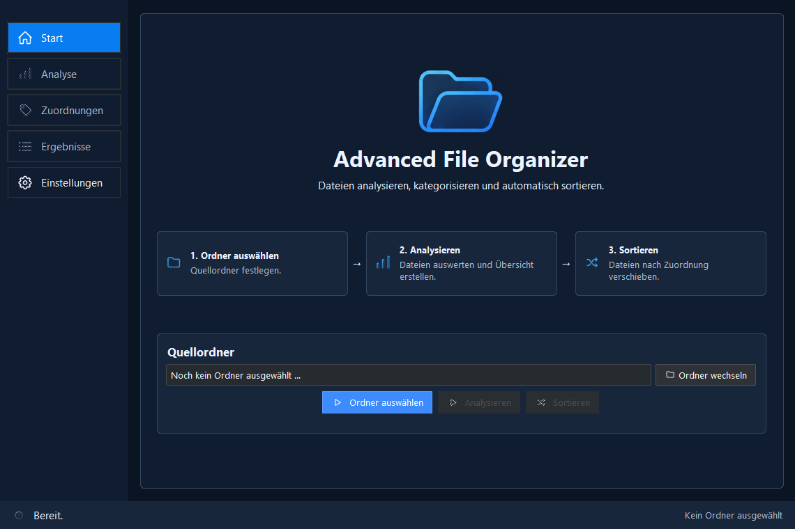

# Datei-Organizer

Ordner analysieren, Sortierpläne prüfen, Dateien nach Kategorien verschieben und einen protokollierten Lauf rückgängig machen. CLI und Desktop-Oberfläche verwenden dieselben Einstellungen und denselben Sortierservice.

## Start



Im Projektordner mit Python und Poetry:

```console
poetry install
poetry run gui-organizer
poetry run cli-organizer --help
```

Die Desktop-App benötigt Tk und eine grafische Sitzung. Sie lädt `config.json` aus dem Arbeitsverzeichnis. Über die Seitenleiste sind Start, Analyse, Zuordnungen, Ergebnisse und Einstellungen erreichbar. Unter Zuordnungen lassen sich Dateiendungen hinzufügen, bearbeiten, verwerfen und speichern.

## Ein Sortierlauf

```console
poetry run cli-organizer analyse
poetry run cli-organizer sortiere --dry-run
poetry run cli-organizer sortiere
poetry run cli-organizer rueckgaengig
```

Jeder Befehl fragt nach dem Arbeitsordner. Enter übernimmt die Vorgabe. Mit `--config PFAD` lässt sich pro Befehl eine andere Konfiguration laden. Der Dry-Run zeigt geplante Zielpfade und Konflikte. Erst ein bestätigter regulärer Lauf verschiebt Dateien. Ein nach der Vorschau hinzugekommenes Ziel wird bei der Ausführung erneut berücksichtigt.

Beispiel: Bei der Zuordnung `.txt → texte` soll `Post/bericht.txt` nach `texte/bericht.txt`. Ist dieses Ziel belegt, kann der Organizer nachfragen, die Quelle überspringen oder den ersten freien Namen ab `bericht_2.txt` verwenden. Bei erhaltener Ordnerstruktur lautet das Ziel `texte/Post/bericht.txt`. Die Ergebnisübersicht nennt den tatsächlichen Zielpfad und zählt verschobene, übersprungene, fehlgeschlagene und abgebrochene Vorgänge.

## Einstellungen

Bestehende Konfigurationen mit `ordner` und `kategorien` funktionieren weiterhin. Das optionale Objekt `optionen` wird von der Einstellungsseite gespeichert. Beispiel:

```json
{
  "ordner": "testdateien",
  "kategorien": {".txt": "texte", ".pdf": "dokumente"},
  "optionen": {
    "recursive": true,
    "max_depth": 2,
    "extensions": ".txt,.pdf",
    "min_bytes": 1,
    "max_bytes": null,
    "modified_from": "",
    "modified_until": "",
    "hidden": false,
    "preserve_structure": true,
    "conflict": "ask",
    "logging": true,
    "theme": "bootstrap-dark"
  }
}
```

- Tiefe **0** umfasst Dateien direkt im Quellordner. Tiefe **1** umfasst zusätzlich seine unmittelbaren Unterordner. Bei aktivierter Rekursion bedeutet `null` unbegrenzte Tiefe.
- Endungen werden ohne Beachtung der Großschreibung verglichen. Leere Endungs- und Datumsfelder setzen keine Grenze. Größen in Bytes und lokale Änderungsdaten im Format `JJJJ-MM-TT` gelten einschließlich der angegebenen Grenzen.
- Unter Windows berücksichtigt die Option für versteckte Dateien auch das Hidden-Attribut. Verzeichnisse mit Kategorienamen direkt unter dem Arbeitsordner, das Journalverzeichnis und Verknüpfungen werden bei der rekursiven Suche ausgelassen.
- Die Konfliktstrategie ist `ask`, `skip` oder `rename`. Die App erkennt auch Kollisionen zwischen zwei Dateien desselben Plans.
- Während der Ermittlung der Dateianzahl zeigt die GUI eine laufende Fortschrittsanzeige. Bei bekannter Gesamtzahl zeigt sie verarbeitete Dateien, Prozent und Fehler. Ein Abbruch greift zwischen Dateien. Bereits abgeschlossene Verschiebungen bleiben im Journal.

## Journal und Rücknahme

Die SQLite-Datei `~/.datei-organizer/moves.sqlite3` enthält die Laufhistorie je Quellordner. Der Speicherort ist über `DATEI_ORGANIZER_HISTORY` konfigurierbar. Vor dem Verschieben werden Quelle, Ziel, Änderungszeit und SHA-256-Prüfsumme protokolliert. Die Rücknahme bearbeitet den letzten noch offenen Lauf in umgekehrter Reihenfolge. Vorhandene Originale, veränderte oder fehlende Zieldateien und verknüpfte Pfade werden mit einem Fehler gemeldet. Ungeklärte Einträge bleiben für einen erneuten Versuch erhalten. Angelegte Kategorieordner bleiben bestehen.

Das optionale Betriebslog `Hauptlog.log` rotiert im Arbeitsverzeichnis. Das Abschalten des Betriebslogs lässt die Rücknahme verfügbar. Bei einem harten Prozessabbruch während einer einzelnen Dateioperation kann eine manuelle Prüfung nötig sein.

## Tests

```console
poetry run python -m pytest tests -q
```

Dateitests arbeiten in temporären Ordnern mit eigenem Journal. GUI-Tests benötigen eine grafische Sitzung. Der Junction-Test läuft unter Windows.
